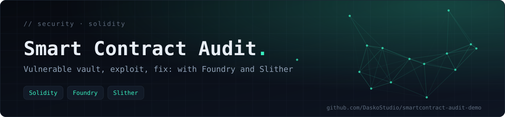
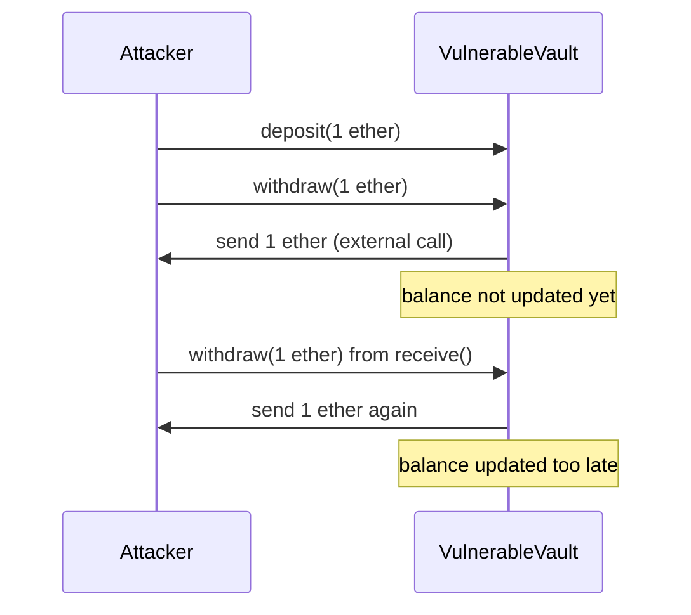

<div align="center">



**A small, self-contained security audit: a deliberately vulnerable Solidity vault, its fixed version, and Foundry tests that exploit the first and show the second holds its funds.**

   

[What this demonstrates](#-what-this-demonstrates) · [Tech stack](#-tech-stack)

</div>

> [!NOTE]
> **Educational example only.** Written from scratch for this repository. No real contract, no mainnet target, no sensitive data. The vulnerabilities are intentional and the exploit contract only runs inside a local Foundry test.

## 📖 What this demonstrates

A typical audit workflow in miniature: read the code, run static analysis, write a proof of concept that confirms the issue, apply a fix, and keep a test that guards against regression.

## 🔎 Findings

| # | Vulnerability | Where | Severity | Fix |
|---|---|---|---|---|
| 1 | **Reentrancy** — the external call happens before the balance is updated | `VulnerableVault.withdraw` | High | Checks-effects-interactions ordering plus a `nonReentrant` lock |
| 2 | **Authorisation through `tx.origin`** — a malicious contract can relay a call made by the owner | `VulnerableVault.emergencyWithdraw` | Medium | Check `msg.sender` instead of `tx.origin` |

## 💥 How the reentrancy exploit works



`VulnerableVault.withdraw` sends the funds with a low-level call **before** it decrements the sender's balance:

```solidity
function withdraw(uint256 amount) external {
    require(balances[msg.sender] >= amount, "solde insuffisant");
    (bool ok, ) = msg.sender.call{value: amount}("");   // external call first
    require(ok, "transfert echoue");
    balances[msg.sender] -= amount;                      // state update too late
}
```

The `Attacker` contract in `test/Audit.t.sol` deposits 1 ether, withdraws it, and re-enters `withdraw` from its `receive()` function while the vault still believes the balance is untouched. The vault is drained beyond the attacker's legitimate deposit, which the test asserts.

## 🩹 The fix

`FixedVault` applies three changes:

```solidity
function withdraw(uint256 amount) external nonReentrant {   // 1. reentrancy lock
    if (balances[msg.sender] < amount) revert InsufficientBalance();
    balances[msg.sender] -= amount;                           // 2. effects before interactions
    (bool ok, ) = msg.sender.call{value: amount}("");
    if (!ok) revert TransferFailed();
}

function emergencyWithdraw() external {
    if (msg.sender != owner) revert NotOwner();               // 3. msg.sender, not tx.origin
    payable(owner).transfer(address(this).balance);
}
```

It also uses custom errors and an `immutable` owner.

## 🔬 Reproduce the audit

**Static analysis (Slither)**

```bash
pip install slither-analyzer
slither src/VulnerableVault.sol
```

**Tests and proof of concept (Foundry)**

```bash
forge install foundry-rs/forge-std
forge test -vvv
```

| Test | What it checks |
|---|---|
| `testReentrancyDrainsVulnerableVault` | The attacker contract drains the vulnerable vault below the legitimate 5 ether deposit |
| `testFixedVaultKeepsFunds` | The fixed vault keeps deposited funds intact |

## 🗂️ Project structure

```text
src/VulnerableVault.sol   Intentionally vulnerable contract (demo)
src/FixedVault.sol        Corrected contract
test/Audit.t.sol          Foundry tests, including the Attacker contract
foundry.toml              Compiler 0.8.20, optimizer enabled (200 runs)
```

## ⚠️ Limits of this demo

- The reentrancy exploit has a dedicated test; the `tx.origin` issue is shown in the source and flagged by static analysis, but has no exploit test.
- The second test checks fund integrity of the fixed vault; a natural extension is to run the same `Attacker` against `FixedVault` and assert that the attack reverts.
- This is a teaching example, not a complete audit methodology (no fuzzing, invariants or formal verification).

## 🧰 Tech stack

Solidity 0.8.20 · Foundry (forge, forge-std) · Slither

---

<div align="center">

<sub>Built by <a href="https://github.com/DaskoStudio"><b>Konaté Adama</b></a> · <a href="https://github.com/DaskoStudio?tab=repositories">More projects</a></sub>

</div>
